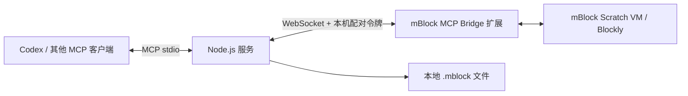

# mBlock MCP

本仓库包含 **MCP 服务端、mBlock 本地扩展、打包与安装脚本、测试及使用文档**。它面向 mBlock 5.6.0，旨在让 MCP 客户端通过程序接口读取项目、编辑积木、运行角色脚本和导出完整项目。

**当前版本：0.1.0，实验性实现。** 编译、5 项自动测试、MCP 协议握手和 13 个工具注册已验证；**真实 App 的扩展加载、积木写入、运行、导出闭环尚未验收**。源码完整不等于已完成 App 集成验证，请先在测试项目中验收。

## 工作方式



积木编辑的实现通过扩展访问 mBlock 的 VM/Blockly，不依赖鼠标拖拽。界面操作只用于首次加载扩展，以及人工核对结果。

服务仅监听 `127.0.0.1:17865`，扩展主动连接服务。客户端负责启动 stdio 服务，不需要额外的后台常驻进程。依赖 mBlock 的内部 `app._mCtx` 接口，**并非 Makeblock 官方 MCP 或稳定 API**；更换 App 版本需要重新验证。

## 能力与验证范围

| 项目 | 状态 |
| --- | --- |
| TypeScript 编译、扩展 ZIP 打包 | 已通过 |
| 配对校验、错误传播、超时、断线、脚本构造、素材校验 | 自动测试已通过 |
| MCP initialize、tools/list、离线错误、参数拒绝 | 已通过协议测试 |
| 真实 App 扩展加载、读写与运行 | 已实现适配代码，待联调验收 |
| 完整项目从 App 导出后再次打开 | 已实现，待联调验收 |
| 机器人运行、设备上传、固件操作 | 不支持 |
| 任意 JavaScript、Shell 执行、通用文件读取 | 不提供 |

写入和运行工具限制为舞台/角色目标。读取工具可以列出设备，但这不代表支持控制设备。运行一个角色脚本仍会执行该脚本原有的广播、扩展等逻辑，应先检查脚本内容。

## 环境要求

- Node.js **22 或更高版本**，以及 npm。
- 已安装 mBlock 5.6.0 桌面 App。当前接口研究基于 macOS 版 5.6.0.31。
- 支持 stdio 的 MCP 客户端，或本仓库自带的测试客户端。
- 本地安装脚本假设扩展目录为用户主目录下的 `mblock/exts`；其他系统和安装布局尚未验证。

## 快速开始

### 1. 获取源码并构建

```sh
git clone "https://github.com/dracohu2025-cloud/mBlock.git"
cd "mBlock"
npm ci --ignore-scripts
npm run build
npm test
```

构建会生成：

| 路径 | 用途 |
| --- | --- |
| `dist/server.js` | MCP 服务入口 |
| `artifacts/mblock-mcp-bridge.mext` | 包含 `manifest.json` 和完整 UMD 代码的扩展包 |
| `.local/bridge.json` | 本机端口与随机配对令牌 |

**扩展包包含本机配对令牌，因此不随源码发布，也不应分享。** 每台电脑应自行构建；再次构建会复用本机配置。`.local/`、`artifacts/`、`dist/` 和 `node_modules/` 均被 Git 忽略。

### 2. 加载扩展

先保存当前工作，并使用测试项目。可尝试将生成的 `.mext` 文件拖入 mBlock。

仓库还提供本地安装脚本。显式传入 `--confirm` 后，它会备份本地扩展注册表及本扩展旧文件，然后仅新增/更新 `codex_mcp_bridge`：

```sh
node "scripts/install-bridge.mjs" --confirm
```

安装目标是 `~/mblock/exts/codex_mcp_bridge/` 和注册表 `~/mblock/exts/ext.json`；备份保存在 `.local/install-backup-时间戳/`。脚本不修改 mBlock App 安装包或 MCP 客户端配置。安装脚本在真实 App 环境中的效果也仍待验收。

在 mBlock 中打开“添加扩展 → 本地角色扩展”，选择 **MCP Bridge**。如果 App 已缓存扩展列表，保存项目后重启 App。服务启动后，扩展中的状态积木应显示“已连接”；以 `mblock_status` 的实际返回为最终判断。

### 3. 连接 MCP 客户端

以 [mcp.example.json](mcp.example.json) 为模板，替换 Node 和项目路径。GUI 客户端可能没有终端的 `PATH`，建议使用 Node 的绝对路径，可通过 `command -v node` 查询。

通用 MCP JSON 配置：

```json
{
  "mcpServers": {
    "mblock": {
      "command": "/absolute/path/to/node",
      "args": ["/absolute/path/to/mBlock/dist/server.js"]
    }
  }
}
```

Codex TOML 配置示例：

```toml
[mcp_servers.mblock]
command = "/absolute/path/to/node"
args = ["/absolute/path/to/mBlock/dist/server.js"]
```

保存到客户端使用的配置后，重新加载其 MCP 连接。服务通过自身文件位置定位配置，因此不依赖客户端的工作目录。

**同一端口只能启动一个服务，且一个服务只接受一个已配对的 App 连接。** 使用正式客户端前，先退出独立测试客户端。

## 工具清单

`target` 接受目标 ID 或唯一名称；建议先查询目标，再使用 ID。分页参数默认 `offset=0`、`limit=100`，上限 500。

| 工具 | 主要参数 | 行为 |
| --- | --- | --- |
| `mblock_status` | 无 | 查询连接；已连接时向 App 读取实际状态 |
| `mblock_list_targets` | 无 | 列出舞台、角色和设备的 ID、坐标、积木数 |
| `mblock_list_blocks` | `target`, `offset`, `limit` | 读取 VM 积木、输入、字段和连接关系 |
| `mblock_list_opcodes` | `query`, `offset`, `limit` | 搜索 App 当前已加载的积木类型 |
| `mblock_add_script` | `target`, `blocks`, `x`, `y` | 添加结构化脚本，读回 VM 后返回；不自动运行 |
| `mblock_add_blocks_xml` | `target`, `xml` | 添加 Blockly XML，支持字段 ID 和 mutation |
| `mblock_set_block_field` | `target`, `blockId`, `field`, `value` | 修改字段，返回实际值及原值 |
| `mblock_list_variables` | `target` | 读取目标自身的变量和列表；全局变量查询舞台 |
| `mblock_create_variable` | `target`, `name`, `value` | 创建非云变量；重名时报错 |
| `mblock_set_variable` | `target`, `name`, `value` | 修改已存在变量；不自动创建 |
| `mblock_run_script` | `target`, `blockId` | 启动指定顶层脚本；已经运行则报错 |
| `mblock_stop_target` | `target` | 停止指定舞台/角色的脚本 |
| `mblock_export_project` | `path` | 导出完整 `.mblock` 到新文件，校验素材和元数据 |

成功响应的 `structuredContent.result` 包含结果，同时提供同内容的 JSON 文本。操作失败返回 `isError: true` 和具体错误，不将离线、App 异常或超时包装为成功。

## 使用示例

不配置正式 MCP 客户端也可启动独立测试客户端：

```sh
node "scripts/probe.mjs"
```

客户端会自动启动服务。每行输入一个 JSON 请求；`tools` 列出工具，`quit` 停止测试客户端及其子进程。以下请求是预期使用方式，仍需完成真实 App 验收。

### 查询和添加脚本

```json
{"name":"mblock_status","arguments":{}}
{"name":"mblock_list_targets","arguments":{}}
{"name":"mblock_list_blocks","arguments":{"target":"Panda"}}
{"name":"mblock_add_script","arguments":{"target":"Panda","blocks":[{"opcode":"event_whenflagclicked"},{"opcode":"control_repeat","inputs":{"TIMES":3},"substack":[{"opcode":"motion_movesteps","inputs":{"STEPS":10}}]}]}}
```

`Panda` 需替换成实际目标。脚本节点使用 `opcode` 指定积木类型；`fields` 指定字段，`inputs` 指定文本、数字或嵌套积木，`substack` / `substack2` 指定控制分支。默认插入位置为 `(80,80)`。

用添加结果的 `topLevelIds[0]` 作为运行参数：

```json
{"name":"mblock_run_script","arguments":{"target":"Panda","blockId":"替换为返回的顶层积木ID"}}
{"name":"mblock_list_targets","arguments":{}}
```

`started: true` 只表示已启动，**不表示执行完成**。通过随后读回的坐标、变量或舞台效果验证执行结果。

### 修改已有字段

先调用 `mblock_list_blocks` 找到对应字段。数字/文本输入通常属于相连的 `shadow` 积木，例如数字输入的字段名为 `NUM`：

```json
{"name":"mblock_set_block_field","arguments":{"target":"Panda","blockId":"替换为数字shadow积木ID","field":"NUM","value":"20"}}
```

返回 `actual` 是 App 校验后的实际字段值；不要仅凭输入参数推断修改结果。

### 变量与导出

```json
{"name":"mblock_create_variable","arguments":{"target":"Panda","name":"MCP_TEST","value":0}}
{"name":"mblock_set_variable","arguments":{"target":"Panda","name":"MCP_TEST","value":42}}
{"name":"mblock_list_variables","arguments":{"target":"Panda"}}
{"name":"mblock_export_project","arguments":{"path":"/absolute/path/to/output/Test.mblock"}}
```

导出路径必须是以 `.mblock` 结尾的绝对路径，父目录必须已存在。服务拒绝覆盖现有文件，并检查原始素材以及 `mscratch.json`、`mblock5` 元数据。当前导出上限为 40 MiB。

## 故障排查

| 现象或错误 | 排查方式 |
| --- | --- |
| `connected: false` / `BRIDGE_OFFLINE` | 检查扩展是否已加载、服务是否启动，是否使用同一台电脑上同次配对配置生成的包 |
| `EADDRINUSE` | 关闭占用 17865 端口的另一份 MCP 服务或测试客户端 |
| `UNSUPPORTED_APP` | App 内部接口不兼容；重新核对版本，不应跳过校验 |
| `TARGET_NOT_UNIQUE` | 使用 `mblock_list_targets` 返回的目标 ID |
| `UNKNOWN_OPCODE` | 查询 `mblock_list_opcodes`，确认对应扩展已在 App 中加载 |
| `VARIABLE_NOT_FOUND` | 确认变量所属目标；舞台全局变量与角色变量分开查询 |
| `BRIDGE_TIMEOUT` / `BRIDGE_DISCONNECTED` | 写入结果可能未知，先读回状态，勿自动重试写操作 |
| `MISSING_ASSETS` / `MBLOCK_METADATA_MISSING` | 导出不完整，保持报错并排查 App 序列化；不要宣称文件可正常使用 |
| `EEXIST` | 更换导出文件名；不会覆盖旧项目 |

需要更换端口时，停止服务，修改 `.local/bridge.json` 中的 `port`，重新构建并重新加载扩展，使双方配置一致。

## 本地数据与恢复

- 服务只绑定本机回环地址；WebSocket 需要配对令牌，并校验来源为本机 mBlock 使用的 HTTP Origin。
- 这不是针对同一操作系统用户的隔离边界；能够读取本地令牌的进程仍可配对。
- 项目内容会通过调用工具的 MCP 客户端进入该客户端上下文，本项目本身不另设云端中转。
- 新增积木使用 Blockly 事件同步 VM；实现中包含失败回滚逻辑，真实 App 下的回滚行为仍需验收。
- 停止 MCP 客户端启动的服务，即可关闭本地读写连接。
- 安装脚本备份在 `.local/install-backup-时间戳/`。手动恢复前先退出 App，并检查备份之后是否安装了其他扩展，避免直接恢复旧注册表覆盖后续变更。

## 项目结构与验证资料

```text
src/                  MCP 工具、连接管理、脚本构造、项目校验
bridge/               mBlock 扩展生命周期与 VM/Blockly 适配
scripts/              扩展打包、本地安装、交互测试客户端
tests/                自动测试
mcp.example.json      通用客户端配置模板
MCP_IMPLEMENTATION.md 本仓库验证记录与待完成验收项
MCP_VERIFICATION.md   初始第三方实现调查，非本仓库验收报告
```

服务协议、App 适配、脚本构造和文件校验各自负责单一职责，统一处理参数和错误。当前范围不包含项目删除、硬件上传和后台常驻服务。

详见 [实现验证记录](MCP_IMPLEMENTATION.md) 和 [第三方调查记录](MCP_VERIFICATION.md)。
